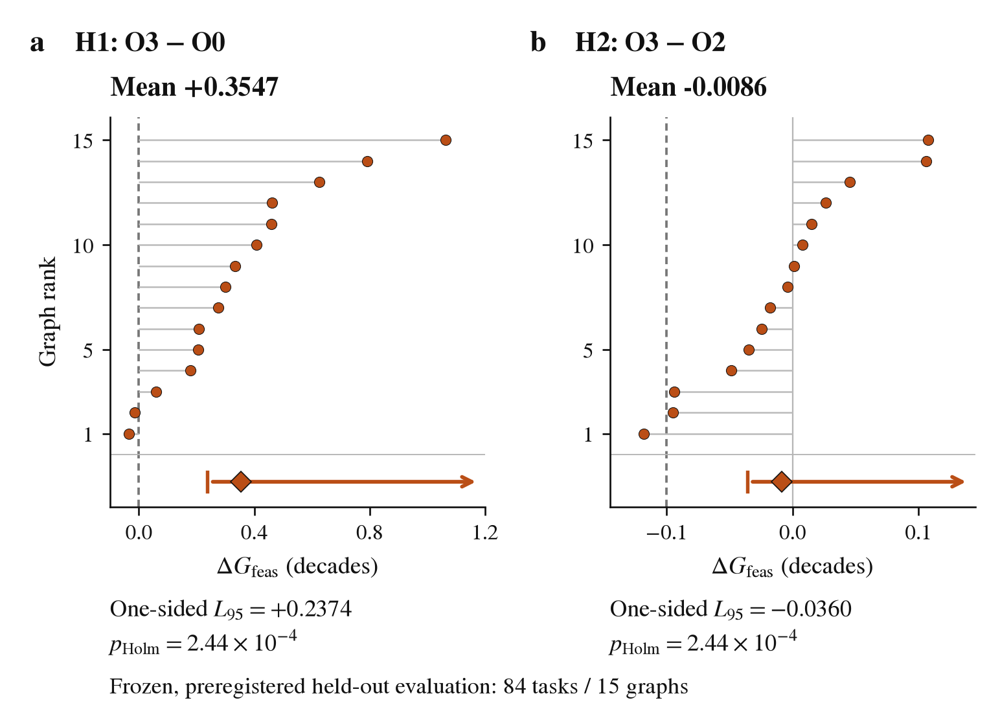
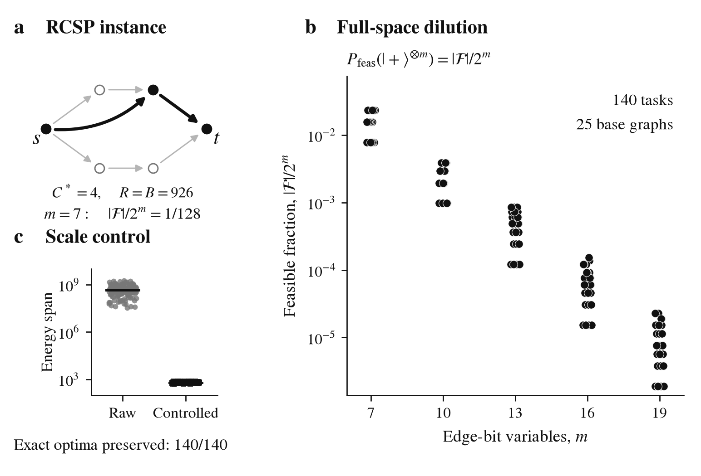
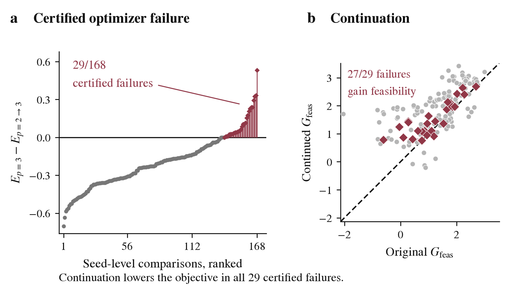
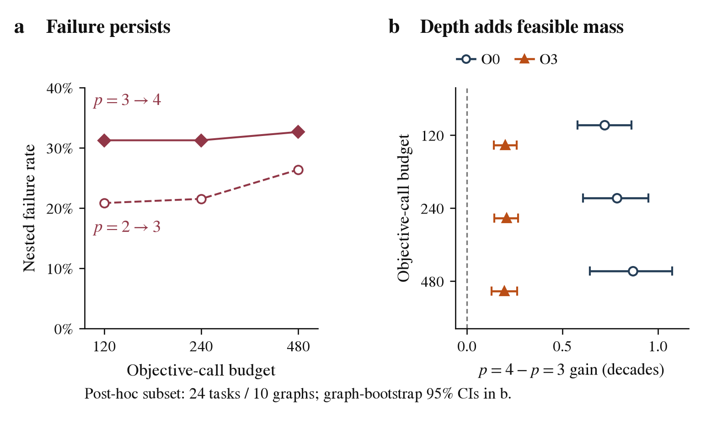

# Penalty-X QAOA: A Controlled RCSP Study

**Feasible-Space Dilution and Objective Alignment in Shallow Penalty-X QAOA**
Zhilin Chen · University of Copenhagen

> **TL;DR** — When QAOA searches for constrained shortest paths, valid routes are
> an exponentially tiny fraction of the quantum state space. Swapping the training
> objective from mean energy to **lower-tail CVaR** recovers almost all of the
> feasibility that is recoverable — confirmed on a frozen, preregistered held-out set.

<p align="center">
  
</p>

<p align="center"><sub><b>Headline result (held-out, 84 tasks / 15 graphs).</b>
Left: CVaR beats mean-energy training on 13 of 15 graphs (+0.35 decades of feasible probability).
Right: CVaR is non-inferior to directly maximizing feasibility (margin −0.10, lower bound −0.036).</sub></p>

## The problem in one picture

<p align="center">
  
</p>

Encoding a route as one bit per edge means the feasible routes shrink from
~10⁻² to ~10⁻⁶ of all bitstrings as the graph grows (**b**). So a shallow QAOA
starting from uniform superposition almost never samples a valid route. We first
rule out the boring explanation — raw penalty Hamiltonians span ~10⁹ in energy,
so we rescale them while keeping all 140/140 exact optima (**c**).

## What we found

| Question | Answer |
| --- | --- |
| Is poor performance just the optimizer? | **Partly.** 29/168 runs are certified optimizer failures (deeper circuit did worse than shallower); a continuation start fixes the objective in 29/29 and raises feasibility in 27/29. |
| Is the training objective the real bottleneck? | **Yes.** CVaR closes a median **97.9 %** of the gap between mean-energy training (O0) and a feasibility-oracle ceiling (O2). |
| Does it hold on unseen data? | **Yes.** Preregistered held-out test: H1 (CVaR > mean energy) **+0.355** decades, L95 = +0.237; H2 (CVaR ≈ oracle) **−0.009**, L95 = −0.036; both Holm p = 2.4×10⁻⁴. |
| Does it scale? | **Not indefinitely.** At m = 20 the CVaR-vs-mean-energy scaling advantage reverses; m = 22 exceeds the frozen compute budget. |
| Do more optimizer calls fix it? | **No.** Failure rates stay ~21–33 % from 120 to 480 calls (Fig. 4). |

**Scope.** These are controlled, exact-statevector results on one RCSP benchmark.
They do not claim quantum advantage, a universal scaling law, or that constrained
QAOA fails in general.

<details>
<summary><b>More figures</b> (optimizer diagnosis, budget robustness)</summary>

<p align="center"></p>
<p align="center"></p>

</details>

## Benchmark at a glance

- **140** corrected tasks on **25** graphs, m = 7–19 edge-bit qubits
- Discovery split 56 tasks / 10 graphs; held-out split 84 tasks / 15 graphs
- Objectives: O0 mean energy · O1 expected penalty · O2 exact feasibility (capacity control) · O3 CVaR
- Scaling study: 180 tasks on 30 graphs; graphs are the independent statistical units

## Installation

Tested on Linux with Python 3.11.15. Install the pinned scientific stack and pytest:

```bash
git clone https://github.com/ZhilinChen02/Penalty-X-QAOA-A-Controlled-RCSP-Study.git
cd Penalty-X-QAOA-A-Controlled-RCSP-Study
python3.11 -m venv .venv
source .venv/bin/activate
python -m pip install -r requirements-dev.txt
python -m pip install --no-deps -e .
```

Alternatively, `conda env create -f environment.yml` followed by
`conda activate qroute-release` installs the same minimal stack. Editable
installation is intentional: experiment modules locate configs and results
relative to this checkout. A standalone wheel without these files is insufficient.

## Quick start

```bash
python scripts/smoke_test.py
python scripts/verify_release.py
pytest -q
```

The existing smoke configuration runs 12 small tasks and writes 36 rows to a
new temporary workspace. It exercises graph generation, exact feasibility,
Hamiltonians and small QAOA optimization. No HPC system is needed.

## Reproduce results

```bash
python scripts/reproduce_core_results.py
```

This reconstructs core statistics from compact frozen tables, checks 21 headline
values, graph-level H1/H2 inference, benchmark splits, stored scaling exponents,
resource censoring and theory numerical residuals. It also checks file hashes
and figure inputs. It performs no optimization or scaling refit and writes no
canonical results. The retained tables include complete matched comparisons,
negative outcomes and failed/censored statuses.

Full experiments are opt-in and expensive; they must run in a separate experiment
workspace. The stage map, seeds, budgets and historical freeze prerequisites are
in [docs/EXPERIMENTS.md](docs/EXPERIMENTS.md). Different optimizer environments may
produce different trajectories; keep reruns separate from the paper's results.

## Reproduce figures

```bash
python scripts/reproduce_figures.py
# Include the finite-shot supplementary figure, in a different new directory:
python scripts/reproduce_figures.py --supplementary --output-dir dist/figures_with_supplement
```

The default output is a new `dist/reproduced_figures/`, containing PDF and PNG.
Existing directories are protected against replacement. Plotting uses frozen
inputs and stored confidence intervals. The final four main figures are in
[figures/main/](figures/main/), with one PDF and one PNG per figure.

## Repository structure

| Directory | Contents |
| --- | --- |
| `src/qroute_dilution/` | Benchmark, Hamiltonians, exact simulation, objectives, optimizers, statistics and theory |
| `configs/`, `data/manifests/` | Seeds, graph/task definitions, resource budgets and discovery/held-out splits |
| `results/` | Compact canonical tables in their original phase paths; `manifest.json` records hashes and provenance |
| `results/headline_results.csv` | Frozen headline values and paper display values |
| `scripts/` | Verification, smoke, plotting, task materialization and original experiment drivers |
| `figures/main/`, `figures/supplementary/` | Final main figures and finite-shot supplement |
| `tests/` | Public-data scientific invariants and integrity checks; optional CUDA infrastructure check |
| `docs/` | Reproduction, experiment map, result provenance and scoped theory statements |
| `analysis/`, `protocols/` | Frozen post-hoc protocol and preregistration |

Original phase paths are retained to preserve imports and manifest references.
[RESULT_PROVENANCE.md](docs/RESULT_PROVENANCE.md) maps each claim to its data and
analysis. Redundant manuscript packages, optimizer traces and internal reviews
are not part of the current source tree.

## Computational requirements

The scientific simulator uses NumPy on **CPU**. Smoke, verification, tests and
replotting need neither CUDA nor HPC. PyTorch is optional for a small CUDA
infrastructure test; it is not a scientific simulation backend.

A complex128 statevector alone uses `16 * 2**m` bytes: 16 MiB at m=20 and 64 MiB
at m=22. Energy arrays, masks, additional states and parallel workers add memory.
Runtime also grows with depth, evaluations, seeds and tasks. These are storage
identities, not measured whole-process resource limits. The reported m=22
censoring reflects the frozen protocol's computational budget.

## Citation

Use [CITATION.cff](CITATION.cff) for machine-readable author, title and repository
metadata. DOI and arXiv identifiers will be added when assigned.

```bibtex
@misc{chen2026penaltyx,
  author = {Chen, Zhilin},
  title = {Feasible-Space Dilution and Objective Alignment in Shallow Penalty-X QAOA: A Controlled RCSP Study},
  year = {2026},
  howpublished = {Companion research code},
  url = {https://github.com/ZhilinChen02/Penalty-X-QAOA-A-Controlled-RCSP-Study}
}
```

## License

Original project code is released under the [MIT License](LICENSE), copyright
2026 Zhilin Chen. Third-party font components retain their own license; see
[THIRD_PARTY_NOTICES.md](THIRD_PARTY_NOTICES.md). No third-party LaTeX templates,
external datasets or downloaded papers are bundled.

## Archive and citation

The permanent archive of this repository is
<https://doi.org/10.5281/zenodo.24356887>.
[`analysis/posthoc_revision_analyses.py`](analysis/posthoc_revision_analyses.py)
contains the post-hoc (not preregistered) analyses added for the revised
manuscript.
