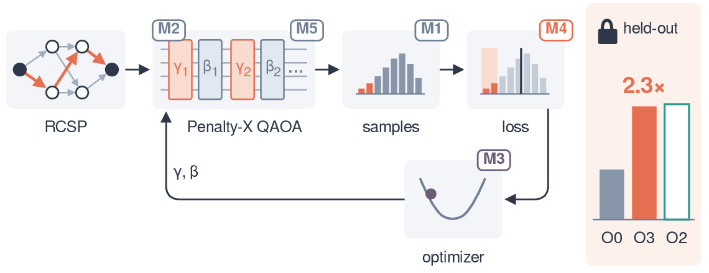
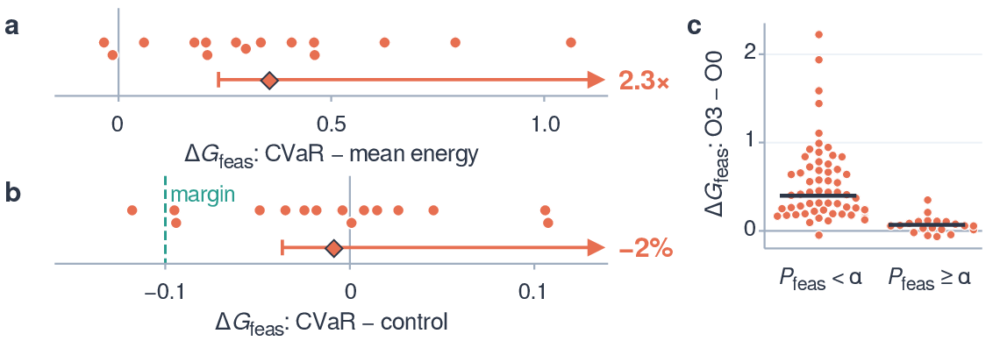
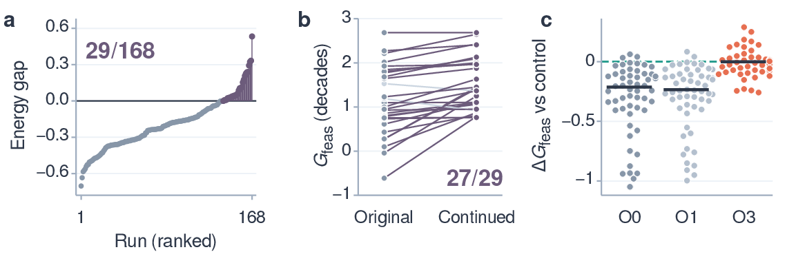

# CVaR training and feasible sampling in shallow penalty-based QAOA

**Code and frozen results for *Conditional value-at-risk training improves
feasible-solution sampling in shallow penalty-based QAOA for
resource-constrained shortest paths***
Zhilin Chen · University of Copenhagen ·
archive [doi:10.5281/zenodo.24356887](https://doi.org/10.5281/zenodo.24356887)

> **TL;DR** — QAOA with penalty terms and the standard X mixer searches all bit
> strings, so it often samples feasible routes with low probability. In exact
> simulations of 140 resource-constrained shortest-path (RCSP) instances, I
> separate five candidate causes. Optimizer failures are real (29 of 168
> three-layer runs, certified by an exact nesting test), but the mean-energy
> loss is also misaligned with feasibility. Training on the lower-tail
> **CVaR** raised the feasible probability **2.3-fold** on 84 preregistered
> held-out instances and came within **2 %** of a feasibility control.

<p align="center">
  
</p>

<p align="center"><sub><b>Fig. 1.</b> The training loop of Penalty-X QAOA and where
the five candidate mechanisms act. Right: held-out geometric-mean feasible
probability relative to mean-energy training (O0).</sub></p>

## Five candidate causes

| | Mechanism | How the study controls or tests it | Finding |
| --- | --- | --- | --- |
| M1 | **Encoding dilution** — with one qubit per edge, only a fraction φ of the 2^m bit strings is feasible (here down to 1.9×10⁻⁶) | Dilution D = 1.6–5.7 decades across tasks | The baseline every loss works against |
| M2 | **Uncontrolled penalty scale** — quadratic penalties would span 3.4×10⁷ to 1.8×10⁹ | Bounded, normalized penalties (spans 490.51–744.17), all optima preserved | Removed by design |
| M3 | **Optimizer failure** | Exact nesting test: a zero-angle layer embeds each two-layer circuit in three layers | 29 of 168 runs are certified failures |
| M4 | **Objective misalignment** | One circuit, one start, four losses (O0–O3) | Mean energy and expected penalty misaligned; CVaR aligned |
| M5 | **Insufficient capacity** | Feasibility control O2; post-hoc depth p = 4 | Not what limits mean-energy training at p ≤ 3 |

The four losses are O0 mean energy, O1 expected penalty, O2 the feasibility
control (1 − P_feas, a capacity control evaluated exactly) and O3 CVaR with
α = 0.10, the mean energy of the lowest-energy 10 % of outcomes.

## Results

### Preregistered held-out test (84 tasks, 15 new graphs)

<p align="center">
  
</p>

<p align="center"><sub><b>Fig. 3.</b> <b>a</b> H1 and <b>b</b> H2: graph-level
contrasts (dots), their mean (diamond) and one-sided 95 % interval (arrow).
<b>c</b> CVaR gain on the 84 tasks, by whether the CVaR state reached
P_feas ≥ α.</sub></p>

| Hypothesis | Contrast (decades of G_feas) | Mean | One-sided 95 % bound | Null | Holm p | Pass |
| --- | --- | --- | --- | --- | --- | --- |
| H1: CVaR beats mean energy | O3 − O0 | +0.355 | +0.237 | 0 | 2.4×10⁻⁴ | ✓ |
| H2: CVaR non-inferior to the control | O3 − O2 | −0.009 | −0.036 | −0.10 | 2.4×10⁻⁴ | ✓ |

- +0.355 decades is a **2.3-fold** gain in feasible probability; 13 of 15
  graphs favour CVaR. −0.009 decades is about 2 % below the control; the
  preregistered margin allowed 21 %.
- CVaR raised the probability of sampling an optimal route on 80 of 84 tasks,
  while the optimal share of feasible samples rose on 35 and fell on 33, and
  mean-energy training reached the lower mean energy on 81 tasks: the gain
  comes from entering the feasible set, not from better energy minimization.
- The gain is concentrated where the CVaR tail still holds infeasible strings
  (Fig. 3c): median O3 − O0 contrast 0.056 decades on the 20 tasks whose CVaR
  state reached P_feas ≥ 0.10, and 0.386 on the other 64.
- H2 does not hinge on its margin: with data and procedure unchanged, it
  passes for any margin of 0.039 decades or wider (post hoc).

### Discovery set (56 tasks, 10 graphs)

<p align="center">
  
</p>

<p align="center"><sub><b>Fig. 2.</b> <b>a</b> Nesting test: energy gap of each
three-layer run to its embedded two-layer start (168 runs; purple: certified
failures). <b>b</b> Continuation of the 29 failed runs. <b>c</b> G_feas of each
loss minus that of the feasibility control (56 tasks; bars: medians).</sub></p>

- **Optimizer failure (M3).** All 168 embeddings reproduced the two-layer
  state exactly, yet 29 three-layer runs ended at a higher mean energy than
  their embedded point. Continuation lowered the mean energy in all 29 and
  raised G_feas in 27. Failures occurred with COBYLA, Nelder–Mead and SLSQP,
  and larger evaluation budgets did not reduce them.
- **Misalignment (M4).** The feasibility control beat mean-energy training on
  53 of 56 tasks (median 0.219 decades), although mean-energy training reached
  the lower mean energy on 51 of them. Dropping the cost (O1) did not help
  (median 0.242 decades behind the control).
- **CVaR is aligned.** CVaR nearly matched the control (median difference
  0.0069 decades) and, on the 53 tasks where the control won, closed a median
  97.9 % of the control's advantage over mean energy. Whichever of the CVaR and control states had the lower CVaR also
  had the higher P_feas on 47 of 56 tasks (5 ties), against 5 tasks for mean
  energy and 5 for the expected penalty.

### Post-hoc analyses (not preregistered)

| Analysis | Result |
| --- | --- |
| Depth p = 4 (24 tasks) | Certified-failure rates rose from 20.8–26.4 % (p = 2→3) to 31.2–32.6 % (p = 3→4), yet the fourth layer raised G_feas on all ten graphs: depth adds capacity but hampers optimization |
| Tail fraction α | Similar for α = 0.05–0.25, worse for 0.02, 0.50 and 1 (discovery and 18 held-out tasks) |
| Finite-shot sampling | Sign of the exact O3 − O0 difference recovered in 94.8 %, 99.3 % and 100 % of comparisons with 10³, 10⁴ and 10⁵ shots |
| Finite-shot training | Inconclusive: 0.360 decades exactly [0.164, 0.570] → 0.171 [−0.011, 0.386] with 10⁴ shots and 0.125 [−0.005, 0.335] with 10³ |
| Instance size m = 20 | CVaR still beat mean energy on 26 of 30 tasks (+0.40 decades) but trailed the control by 0.15 decades; its P_feas fell faster with dilution (η = 1.282 against 0.615 for mean energy) |
| Instance size m = 22 | No run was made: the predicted 2,250 s per optimization exceeded the preregistered 1,200 s limit |
| Classical context | A label-setting solver needs about 50 µs per task |

**Scope.** These are exact-statevector results on small, synthetic and
classically easy instances (7–19 qubits, p ≤ 3). They support no
quantum-advantage, scaling or hardware claim.

## Benchmark at a glance

- **140** corrected tasks on **25** graphs, m = 7–19 edge-bit qubits
- Discovery split 56 tasks / 10 graphs; held-out split 84 tasks / 15 graphs;
  graphs are the independent statistical units
- Losses: O0 mean energy · O1 expected penalty · O2 feasibility control ·
  O3 CVaR (α = 0.10)
- Scaling study: 180 tasks on 30 graphs, m = 12–22

**Naming.** The paper calls O2 the *feasibility control*; code, configs and
result tables keep its historical name *oracle*. The nesting test is the
*zero-angle embedding* (`p3_random_vs_embedded`) in the tables.

## Installation

Tested on Linux with Python 3.11.15. Install the pinned scientific stack and pytest:

```bash
git clone https://github.com/ZhilinChen02/Penalty-X-QAOA-A-Controlled-RCSP-Study.git
cd Penalty-X-QAOA-A-Controlled-RCSP-Study
python3.11 -m venv .venv
source .venv/bin/activate
python -m pip install -r requirements-dev.txt
python -m pip install --no-deps -e .
```

Alternatively, `conda env create -f environment.yml` followed by
`conda activate qroute-release` installs the same minimal stack. Editable
installation is intentional: experiment modules locate configs and results
relative to this checkout. A standalone wheel without these files is insufficient.

## Quick start

```bash
python scripts/smoke_test.py
python scripts/verify_release.py
pytest -q
```

The existing smoke configuration runs 12 small tasks and writes 36 rows to a
new temporary workspace. It exercises graph generation, exact feasibility,
Hamiltonians and small QAOA optimization. No HPC system is needed.

## Reproduce results

```bash
python scripts/reproduce_core_results.py
python analysis/posthoc_revision_analyses.py .
```

The first command reconstructs core statistics from compact frozen tables,
checks 21 headline values, graph-level H1/H2 inference, benchmark splits,
stored scaling exponents, resource censoring and theory numerical residuals. It
also checks file hashes and figure inputs. It performs no optimization or
scaling refit and writes no canonical results. The retained tables include
complete matched comparisons, negative outcomes and failed/censored statuses.

The second command prints the post-hoc analyses added for the revised
manuscript: the sensitivity of H2 to its margin, the mean scaling exponent η
per size and loss, and the discovery gap closure of O1 and O3. It only reads
frozen tables.

Full experiments are opt-in and expensive; they must run in a separate experiment
workspace. The stage map, seeds, budgets and historical freeze prerequisites are
in [docs/EXPERIMENTS.md](docs/EXPERIMENTS.md). Different optimizer environments may
produce different trajectories; keep reruns separate from the paper's results.
[docs/RESULT_PROVENANCE.md](docs/RESULT_PROVENANCE.md) maps every number above
to its frozen table.

## Figures

**Revised manuscript (Figs. 1–3).** [figures/revision/](figures/revision/)
holds the draw.io sources, the PDFs and the PNGs shown above. Figs. 2 and 3 are
written from the frozen tables:

```bash
python figures/revision/make_drawio_figures.py --repo . --out figures/revision
DRAWIO=/path/to/drawio bash figures/revision/export_figures.sh   # PDF and PNG
```

**Original submission (four figures and a finite-shot supplement).**
[figures/main/](figures/main/) and [figures/supplementary/](figures/supplementary/)
hold one PDF and one PNG per figure; their hashes are part of the release
manifest. Replot them with:

```bash
python scripts/reproduce_figures.py
# Include the finite-shot supplementary figure, in a different new directory:
python scripts/reproduce_figures.py --supplementary --output-dir dist/figures_with_supplement
```

The default output is a new `dist/reproduced_figures/`, containing PDF and PNG.
Existing directories are protected against replacement. Plotting uses frozen
inputs and stored confidence intervals.

## Repository structure

| Directory | Contents |
| --- | --- |
| `src/qroute_dilution/` | Benchmark, Hamiltonians, exact simulation, objectives, optimizers, statistics and theory |
| `configs/`, `data/manifests/` | Seeds, graph/task definitions, resource budgets and discovery/held-out splits |
| `results/` | Compact canonical tables in their original phase paths; `manifest.json` records hashes and provenance |
| `results/headline_results.csv` | Frozen headline values and paper display values |
| `scripts/` | Verification, smoke, plotting, task materialization and original experiment drivers |
| `analysis/` | Frozen post-hoc protocol (`reviewer_robustness/`) and the revision's post-hoc analyses (`posthoc_revision_analyses.py`) |
| `protocols/` | Preregistration |
| `figures/revision/` | Figures of the revised manuscript (draw.io sources, PDF, PNG) and their generator |
| `figures/main/`, `figures/supplementary/` | Figures of the original submission and finite-shot supplement |
| `tests/` | Public-data scientific invariants and integrity checks; optional CUDA infrastructure check |
| `docs/` | Reproduction, experiment map, result provenance and scoped theory notes ([index](docs/theory/README.md)) |

Original phase paths are retained to preserve imports and manifest references.
Redundant manuscript packages, optimizer traces and internal reviews are not
part of the current source tree; the per-run records of the original
executions remain in the initial public commit
`dc4106f03905b8ea86a0596fa2f007a094cfa4b1`.

## Computational requirements

The scientific simulator uses NumPy on **CPU**. Smoke, verification, tests and
replotting need neither CUDA nor HPC. PyTorch is optional for a small CUDA
infrastructure test; it is not a scientific simulation backend.

A complex128 statevector alone uses `16 * 2**m` bytes: 16 MiB at m=20 and 64 MiB
at m=22. Energy arrays, masks, additional states and parallel workers add memory.
Runtime also grows with depth, evaluations, seeds and tasks. These are storage
identities, not measured whole-process resource limits. The m=22 tasks were
censored before any run because the preregistered time guard predicted about
2,250 s per optimization, above the 1,200 s limit.

## Archive and citation

The permanent archive of this repository is
<https://doi.org/10.5281/zenodo.24356887>.
[`analysis/posthoc_revision_analyses.py`](analysis/posthoc_revision_analyses.py)
contains the post-hoc (not preregistered) analyses added for the revised
manuscript.

## Citation

Use [CITATION.cff](CITATION.cff) for machine-readable author, title, repository
and archive DOI metadata.

```bibtex
@misc{chen2026penaltyx,
  author = {Chen, Zhilin},
  title = {Feasible-Space Dilution and Objective Alignment in Shallow Penalty-X QAOA: A Controlled RCSP Study},
  year = {2026},
  howpublished = {Companion research code},
  url = {https://github.com/ZhilinChen02/Penalty-X-QAOA-A-Controlled-RCSP-Study}
}
```

## License

Original project code is released under the [MIT License](LICENSE), copyright
2026 Zhilin Chen. Third-party font components retain their own license; see
[THIRD_PARTY_NOTICES.md](THIRD_PARTY_NOTICES.md). No third-party LaTeX templates,
external datasets or downloaded papers are bundled.
